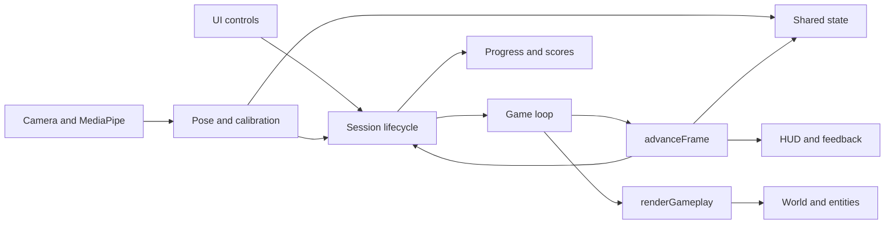

# Canvas 2D architecture

## Intent

Make a future change local and reviewable without changing the current game.
Each subsystem has a closure, a small returned API, and explicit access to shared
state and other capabilities. There is no framework, asynchronous module loader,
or new browser dependency.

## Ownership map

| Location | Responsibility | Main API |
| --- | --- | --- |
| `src/main.js` | Composition and existing inline-handler bridge | Wiring only |
| `src/core/state.js` | Initial session, game, and viewport values | `createState()` |
| `src/game/simulation.js` | Spawn rules, frame updates, scoring, collisions, timers | `spawnObstacle`, `advanceFrame`, `gameLoop` |
| `src/game/tracking-safety.js` | Whole-game pause and stable recovery gate | `updateTrackingSafety`, `isGameplayPaused`, `resetTrackingSafety` |
| `src/game/energy.js` | Per-player time/activity energy estimates and assumptions | `resetEnergy`, `updateEnergy`, `recordEnergyAction`, `suspendEnergy`, `stopEnergy`, `readEnergy` |
| `src/debug/recorder.js` | Opt-in bounded telemetry, browser backup, file saving/export | `record`, `sample`, `transition`, `flushDebugLog`, `finishDebugLog` |
| `src/ui/debug-panel.js` | Debug controls, live counts and candidate annotations | `initializeDebugPanel`, `drawDebugFrame` |
| `scripts/debug-logs.cjs` | Same-origin localhost debug JSON writer | `createDebugLogHandler` |
| `src/game/session.js` | Start/reset a run; finish a run and present its results | `startGameplay`, `gameOver` |
| `src/rendering/viewport.js` | Game canvas, context, size, resize listener | `canvas`, `ctx` |
| `src/rendering/world.js` | Original perspective projection, ground, sky | `getScreenPos`, `drawBackground`, `drawStaticBackground`, `horizonY` |
| `src/rendering/entities.js` | Obstacles, orbs, player animation, shield graphics | `drawOrb`, `drawObstacle`, `updateAndDrawPlayer` |
| `src/rendering/scene.js` | Viewport clipping, draw order, split-screen divider | `renderGameplay` |
| `src/input/pose-inference.js` | Dedicated MediaPipe worker, model loading, bitmap transfer and request lifecycle | `initializePoseInference`, `inferPose` |
| `src/input/camera.js` | Camera lifecycle, fresh worker-result routing, mirrored calibration/gameplay feeds | `initCameraSequence`, `predictWebcam`, `showCalibrationPreview`, `showCameraForMode` |
| `src/input/pose.js` | Calibration, matched input routing, posture recognition, suspension | `beginCalibration`, `onPoseResults`, `checkPlayerTracking`, `handlePlayerMovement` |
| `src/input/calibration.js` | Position readiness, stable timing, neutral-pose sample averaging | `resetCalibration`, `updateCalibration` |
| `src/input/player-tracking.js` | Finalized slots, body/motion matching, loss and ambiguity policy | `resetEnrollment`, `lockPlayers`, `matchPlayers`, `trackingStatuses` |
| `src/input/hand-pointer.js` | Raised-hand selection, mirrored body-relative cursor mapping, smoothing and camera freshness | `observeHandPointer`, `checkHandPointer`, `resetHandPointer` |
| `src/ui/hand-cursor.js` | Cursor/ring DOM, visible-button hit testing and two-second dwell clicks | `updateHandCursor`, `clearHandCursor` |
| `src/ui/tracking-status.js` | Calibration guidance, recovery message and recalibration action presentation | `renderCalibration`, `refreshTrackingStatus`, `clearTrackingStatus` |
| `src/input/arm-postures.js` | Extended level-arm duck geometry and evidence | `readLevelArms` |
| `src/input/lane-gestures.js` | Per-player/arm raise cycles and stable 15-degree rearming | `detectLaneGesture`, `resetLaneGestures`, `interruptLaneGestures` |
| `src/storage/progress.js` | Local-calendar streaks, legacy streak migration, daily reward date keys | `calculateStreak`, `getLocalDateKey` |
| `src/storage/scores.js` | Persistent score tables, demo cleanup, provisional live ranking | `getLeaderboard`, `saveScore`, `getLiveRanking` |
| `src/ui/streak.js` | Day 1 → Day 2 → Day 3 progress and translated messages | `renderStreak` |
| `src/ui/localization.js` | Original dictionaries and translated login controls | `translations`, `setLoginLang`, `updateLanguage` |
| `src/ui/preferences.js` | Theme application and persistence | `updateTheme` |
| `src/ui/controls.js` | Button/input bindings and screen navigation | `bind` |
| `src/ui/tutorial.js` | Slides, instruction audio, tutorial navigation, health tips | `showInstructionsScreen`, `advanceInstruction`, `HEALTH_TIPS` |
| `src/ui/leaderboards.js` | Table rendering, tab state, leaderboard modal | `renderLeaderboard`, `switchLBTab`, `toggleLeaderboard` |
| `src/ui/hud.js` | Single/two-player HUD presentation and gameplay notice placement | `updateHUD`, `layoutGameplayNotices` |
| `src/ui/finish-photo.js` | In-memory final camera image, winner crown, result-photo layout and close/replay lifecycle | `observeFinishPlayers`, `showFinishPhoto`, `closeFinishPhoto`, `resetFinishPhoto` |
| `src/ui/notifications.js` | Gameplay-only orb notifications and cleanup | `showOrbNotify`, `clearOrbNotify` |
| `src/ui/feedback.js` | Present level and shield feedback from the simulation | `showLevelUp`, hide methods |
| `src/ui/warning.js` | Safety-warning audio and its button state | `toggleWarningRead`, `stopWarningAudio` |
| `src/audio/sound.js` | Original synthesizer and background music element | `playSynth`, `bgMusic`, `audioCtx` |
| `src/bootstrap.js` | Restore preferences and initialize the login screen | `initialize` |
| `src/effects/` | Independent background and fireworks animations | Existing fireworks functions |
| `src/config/tailwind.js`, `src/audio/music.js` | Original early page initialization | Original configuration and music selection |
| `styles/game.css`, `index.html` | Original styles, utility classes, markup, assets | DOM IDs are stable integration contracts |
| `assets/` | Tracked images, videos, music, instruction audio, and warning audio | `manifest.json` records resource relocation |

## Resource paths

`assets/images/` contains image files, `assets/videos/` contains tutorial videos,
and `assets/audio/` contains warning audio plus `music/` and `voice/` subfolders.
Media filenames and bytes are retained. The asset folder is deployed with the
game and stays tracked in Git.

Page markup and script-set media URLs resolve from the page. Stylesheet URLs
resolve from `styles/game.css`, so its background URL starts with `../assets/`.
`assets/manifest.json` maps original paths to current paths for reference checks
and regression comparisons; runtime media remains synchronous direct URLs.
`npm run check` validates local HTML, source, and CSS resource references.

## Dependencies and lifecycle

`src/main.js` creates one `state`, one `app` object, and the subsystem factories.
A factory returns named capabilities. Functions call another subsystem through
`app.<subsystem>.<method>`; no game state is exposed on `window`.

Factories can refer to capabilities installed later, but must defer those calls
until callbacks run. All factories are installed before `controls.bind()` and
`bootstrap.initialize()` execute. This permits the existing feedback cycles
between camera, calibration, session control, simulation, and presentation
without relying on browser globals or asynchronous imports.

`advanceFrame()` performs the original logical frame and returns `false` if the
run ended. `gameLoop()` accumulates elapsed animation-frame time into 60 Hz logical steps
and renders only the last surviving step, then schedules the next callback. The scene draws background, orbs, obstacles, player, then
the split-screen divider in the original order.

The build concatenates factory declarations and the composition root into one
classic-script closure. Each subsystem retains its own lexical scope. The
explicit source manifest makes the bundle deterministic and inspectable; source
file markers in the bundle support debugging. Keeping classic scripts preserves
page loading and static hosting without an ES-module server requirement.

The Tailwind configuration, music setup, animated background, and fireworks
remain separate scripts at their original positions in the HTML. The only
explicit game globals are the existing HTML handlers `toggleLeaderboard`,
`switchLBTab`, and `switchGOLBTab`; the independent effects keep their original
`startFireworks` and `stopFireworks` functions.

## State boundaries

- `state.session`: player names, player count, camera initialization status.
- `state.game`: run state, players, score, speed, entities, timers, sky animation,
  reward flags, and the existing orb-spawn thresholds.
- `state.viewport`: current game width and height.
- Private closure state: tutorial step/mute/audio, selected leaderboard tabs,
  MediaPipe objects/video timestamp, audio context, canvas references, per-player
  arm gesture latches, calibration anchors/sample means, calibrated body profiles,
  motion history and tracking status.

State writes are direct and synchronous, matching the original code. Introduce a
new shared field only when multiple subsystems need it. Cross-subsystem constants
and capabilities are returned explicitly; mutable private values are not exported
as stale snapshots.

## Compatibility constraints

Preserve numeric thresholds, frame-based timing, random-call order, storage keys,
player/board mapping, strings, DOM IDs/classes, media content, and external service
versions. The original logic includes behavior that may look unusual:

- The horizon is calculated once at startup, while viewport dimensions resize.
- Orb-spawn score thresholds persist across subsequent runs in the same page.
- The initial speed and later Chill multiplier application follow the original
  frame sequence.
- Drawing updates sky particles and player interpolation and consumes random
  numbers. Rendering is not a pure read-only pass.
- A run ends when either player reaches zero lives.
- Starting a new run resets a particular subset of player fields; it does not
  recreate the full player object.

Changing these requires a separate behavior change and intentional test updates.

## Intentional performance timing and worker changes

Gameplay now follows elapsed time at the original 60-logical-frames-per-second
pace. `simulation.gameLoop(timestamp)` retains the original `advanceFrame()`
thresholds and collision checks on every fixed step, independent of display rate.
Fractional time carries forward; at high refresh rates callbacks without a due
step do not advance or repaint gameplay. At lower rates, intermediate steps call
`scene.advanceVisualFrame()` without Canvas work, and the last step renders in
the original order. World particle/twinkle updates and player interpolation still
advance per logical step, including random consumption in each viewport and
jump flames. The original two-player sky update order is preserved.

Tracking pause/resume, session start, and visibility changes reset the private
frame clock. Hidden-page callbacks do not update or render. A negative time delta
or a gap over 250 ms discards accumulated time rather than replaying stale input
through a large catch-up burst. This bounds each callback to 15 logical steps.
Energy retains its independent real-time estimator and pause exclusion.

`pose-inference.js` owns one dedicated classic Worker created from its bundled
runtime function via a temporary Blob URL. It loads the unchanged MediaPipe
0.10.3 runtime and Lite model with four pose candidates. GPU inference uses an
OffscreenCanvas; GPU initialization failure retries CPU inference inside the
worker. There is no main-thread inference fallback. The Blob URL is revoked after
worker creation. Worker creation/import/model failures preserve the startup error
flow; model initialization is shared across callers. Requests have IDs and
bounded timeouts (30 seconds to initialize, 10 seconds per frame, allowing cold
GPU shader compilation). Worker crashes/timeouts terminate that worker and reject
its request; a subsequent request can initialize a replacement. Individual
inference errors retain the worker for subsequent frames. Transferred bitmaps
are closed in the worker even on inference errors; capture/transfer failures
release the main-thread bitmap.

Camera owns a single in-flight capture/inference operation. While it is pending,
its existing animation loop continues preview drawing and input watchdogs, and
the game keeps rendering independently. Once free, it captures the newest video
frame; no camera-frame backlog is created. Only landmarks and timing return to
the main thread. Matching, calibration, gestures, hand control and game safety
remain in their existing owners. Results over 250 ms old, from reversed camera
time, hidden/paused/ended video, or a different phase/player count/calibration/run
generation cannot provide input. Stale/error results suspend pose input; recovery
still requires fresh matching observations through the existing gates. Explicit
calibration and session start invalidate outstanding results without creating a
second stream, model or loop. Existing diagnostics remain opt-in with no images.

The original compatibility baseline stays at `6778c34`; its 60 Hz game state,
random order and Canvas pixels remain compared. The camera-option exclusion now
also covers the worker's OffscreenCanvas, whose transfer/lifecycle is verified
separately. Browser doubles execute the worker protocol asynchronously while
retaining deterministic external model responses. Dedicated tests compare full
simulation/animation/random state at 15/20/30/60/120/144 Hz in both player and
speed modes; check collisions/game-over, pauses, visibility, stalls and reversed
clocks; reject stale or cross-session results; and exercise worker errors,
restart, transfers, GPU-to-CPU initialization fallback and a real worker that
runs blocking inference while main-thread UI timers stay responsive. Physical
webcam and low-end hardware measurements remain separate verification steps.

## Intentional progress and leaderboard changes

The leaderboard and daily streak behavior were subsequently changed by request:

- Both modes start with empty leaderboards and show a translated empty state.
  `leaderboard_data_version=1` clears legacy demo data once. New real results
  persist across page loads, stay separated by mode, and retain the highest five
  distinct player names. Names are trimmed, Unicode NFC-normalized and compared
  case-insensitively, with macrons/accents retained. Each name has one maximum
  integer score; equal/lower results preserve the existing record and display
  spelling. Higher results use the newly entered spelling. Invalid stored rows
  are discarded when reading. Deduplication precedes the top-five cutoff.
  Startup consolidates both existing boards in place without re-running demo
  cleanup or changing the version key. Runtime reads remain pure; completed
  runs save through `saveScore()`.
- `streak_data_version=1` clears the prototype's unreliable streak counters once,
  including counts inflated for special names. A fresh login starts at day one.
  Names, language, and theme preferences are retained.
- Streaks remain local to this browser. Repeated logins on the same local date
  count once; consecutive dates increment the count; a missed day resets it to
  one. UTC midnight does not define the user's login day.
- The three circles show Day 1, Day 2, and Day 3 from left to right. The earned
  streak number continues increasing after day three; all three milestone circles
  remain complete.
- Five bonus shields require a real streak of at least three days and a login
  today. The reward is claimed once per local date. Special names no longer get
  free streak days or bonus shields.

## Intentional lane gesture changes

A held arm produces one lane intent instead of repeating after a frame cooldown.
`src/input/lane-gestures.js` owns the gesture cycle in a private `WeakMap`, with
separate state for each player and each arm:

1. A qualifying single-arm raise confirmed for 60 ms emits one left/right intent
   and latches the arm.
2. Further raising updates its highest filtered angle. Holding it there emits
   nothing.
3. Lowering by at least 15 degrees from that peak for 150 ms rearms the cycle.
   Continuing downward or holding the lower position still emits nothing.
4. Raising by 15 degrees from the lowest lowered position, while meeting the
   existing raised-arm condition for 60 ms, emits one fresh intent.

A rolling three-sample median filters angle spikes before recording peaks or
lowered positions. Every confirmation also requires at least three samples;
durations use the monotonic clock rather than frame counts. Shoulder and wrist
coordinates must be finite, and any provided visibility/presence score must be
at least 0.6. Uncertain or lost tracking, or a sample gap longer than 250 ms,
clears partial confirmations and release evidence while retaining the held-arm
latch. Reacquiring an already raised arm cannot replay a lane change.

Angles use shoulder-to-wrist vectors in camera pixels, correcting for the video
aspect ratio. Resizing the game viewport does not change the threshold. These
are projected camera angles, not a 3D joint-angle measurement.

The old repeated-lane cooldown is replaced by this gesture cycle. The later
25-observation post-duck cooldown has also been removed: it discarded deliberate
raises after ducking, especially at lower camera rates or when leaving fly through
the arm-level duck pose. Jump/duck/rest recognition remains in `pose.js`. Active
actions block lateral moves; once they end, a confirmed fresh lower/raise cycle
can move immediately. No additional frame timer gates that cycle. Release
confirmation can happen during an active action, but the fresh raise must occur
after that action ends. Raises completed during a blocked action are consumed,
preventing a delayed move from an arm held up afterward. An attempt at the outer
lane boundary is also consumed. Pose loss does not unlock a held arm. Starting a
new run explicitly resets the latches for all participating players.

The retired `actionCooldown` field is excluded from original-baseline player
snapshots; all other fields remain compared. Dedicated transition tests cover
both arms, fly through arm-level duck, arm-level duck and crouching at 15, 20,
30 and 60 camera observations/second. Browser tests cover both player modes,
first fresh raises, held-arm suppression and tracking remaining active. Debug
`input.lane_gate` transitions identify fly, duck, rest, first-frame tracking
recovery, or a clear gate (`blockedBy: null`) for reviewing human tests.

## Intentional level-arm duck changes

The arm-based duck gesture requires both arms extended outward near shoulder
level. The old check only tested whether both wrists were above a generous height
threshold, so hands in front of the chest also counted. Physical crouching remains
a separate duck trigger: average shoulder y must exceed the calibrated baseline
by more than 0.10 of image height. Chest-held hands alone do not trigger duck.

`arm-postures.js` performs stateless camera-space geometry using the camera aspect
ratio and shoulder span. Each wrist must extend outward at least 0.65 shoulder
spans, each elbow 0.2 spans. Wrist direction must be within 20 degrees of horizontal,
and upper-arm direction within 25 degrees. Elbows must be at least 150 degrees
extended. All six shoulder/elbow/wrist landmarks must be finite, with any provided
visibility/presence scores at least 0.6. This allows a natural bend and small height
variation without treating bent, inward or merely chest-height hands as duck.

`pose.js` combines the level-arm result with the crouching check consistently
for the duck flag, squat count and lateral input gate. Fly and crossed-arm rest retain their existing rules and priority.
No additional cooldown or activation delay is introduced. The baseline gameplay
comparison supplies anatomically coherent level-arm/elbow poses to both versions;
dedicated tests reject chest/bent arms while accepting level arms and crouching,
angle tolerances, camera aspects/scales, uncertain joints and both player modes.
Debug observations now include elbows (eight landmarks), and lane-gate transitions
include level-arm geometry and `duckSource`; squat events record `source` as
`level_arms` or `crouch` so the next human test shows which trigger qualified.

## Intentional player-lock changes

Calibration includes a full-frame mirrored live camera canvas inside the card,
visible during both the preparation countdown and calibration. This shows the
whole room in either player mode, so players can check shoulders/hips and extra
people. The canvas bitmap follows the camera's native dimensions; containment
preserves its aspect ratio on small screens. A waiting message replaces empty
frames until video data is ready. The source video is muted and inline, rendered
offscreen at 1px, and started explicitly with `play()` before camera initialization
finishes. Calibration entry retries playback if an existing stream is paused.
The card scrolls on short viewports rather than extending beyond the screen.

`camera.showCalibrationPreview()` clears stale preview pixels and hides the
small gameplay feeds on every calibration entry, including replay and explicit
recalibration. `drawCameraFeeds()` updates it from the existing camera stream;
there is no second stream or permission request. Gameplay restores the original
single/split camera views. Calibration back navigation hides the preview with
its parent card.

The camera owns one animation-frame loop, scheduled explicitly after playback
starts rather than depending on a one-shot `loadeddata` event. Re-entry and
repeated initialization reuse that loop and stream. Playback failures return to
the dashboard with a clear error. Inference failures interrupt pose input but
do not stop preview drawing or future camera frames; calibration displays a
tracking-error message over the live preview until inference recovers.

Player slots are finalized only after explicit calibration completes. Both player
modes use the same position-first flow:

1. Players move freely until their torsos are suitably visible and positioned.
2. Each player immediately starts a 750 ms torso sample (at least five fresh
   observations). There is no separate one-second hold before sampling.
3. Players become ready independently. Once all are ready, require 100 ms and
   three fresh observations with every player currently suitable.
4. Finalize all player locks together after readable guidance has settled.

`calibration.js` keeps per-player anchors, sample means and elapsed valid time
private. Only shoulders and hips determine readiness; wrists can move or have
low confidence without restarting preparation. Required torso landmarks must be
finite, with any provided confidence scores at least 0.6, and fit within 2–98%
of the image. Shoulder widths of 7–42% and vertical torso heights of 12–48% are
accepted, with shoulders at least 12% from the top and hips no lower than 92%.
Shoulder unevenness and natural leaning are allowed relative to torso size.

Single-player hip centers may occupy 20–80% of image width. Two-player centers
may occupy 54–90% and 10–46%, with at least 18% separation (more for wide bodies).
Candidates map to raw-image sides, so detector order does not change slots and a
missing second player never shifts the remaining player into another slot.
Multiple candidates on one side, extra people and overlapping bodies cannot
finalize calibration. Mirroring preserves the existing board assignment.

Torso movement is compared with each player's starting sample, correcting for
camera aspect ratio. The tolerance is 20% of torso height, bounded to 4.5–7% of
image height. Normal hand movement and small natural sway do not affect it.
A brief invalid observation pauses that player's sampling and prevents locking;
it does not discard either player's progress. Invalid time never contributes to
the 750 ms sample. An unsuitable or missing torso for more than 300 ms clears
only that player's sample. The other player can continue getting ready. A camera
gap over 300 ms or a backwards timestamp clears all samples. New suitable poses
begin again automatically without permanent identities or partial game baselines.
Completed samples remain frozen while readable guidance finishes, but fresh
suitable poses and the final confirmation are still required on every completion.

The progress bar averages individual sample progress. English/Māori guidance
identifies which player needs to adjust when possible, and diagnostics include
per-player phases, sample counts and progress. Only intended players should be
present during calibration. The gameplay identity and loss policies below remain
unchanged. Back/re-entry and recalibration reset all preparation.

Calibration copy timing is private to `ui/tracking-status.js`. Both title and
instruction change together no more often than every 1500 ms of monotonic time;
identical camera observations never rewrite text or restart that window. The
latest relevant instruction replaces the previous one after its minimum hold,
without queuing obsolete prompts. Preparation also lasts 1500 ms and is localized.
Language changes use the same hold; a new calibration entry resets presentation.
Progress and validation update immediately even while text is held. A complete
sample cannot finalize locks until the final sampling message has been displayed
for 1500 ms. This may briefly keep progress at 100%, without requiring another
sampling window. Fresh valid camera results must still confirm completion; no
timer can lock stale/bad poses. Dedicated tests cover independent readiness,
short glitches versus prolonged loss, moving hands, body size, invalid completion,
localization and re-entry. Baseline exclusions cover only the two intentionally
changed guidance text values.

`player-tracking.js` owns private slot records independently of detector result
order and mutable game-player objects. It uses finite shoulder/hip landmarks
with any provided visibility/presence scores at least 0.6. Camera aspect ratio
is included in geometry. Body profiles contain shoulder width, hip width, torso length,
and hip/shoulder proportions, derived from averaged neutral landmarks and fixed
afterward. `matchPlayers()` cannot enroll people; only the successful calibration
coordinator calls `lockPlayers()`.
Candidate matching primarily follows the last trusted hip position and bounded
velocity prediction. A candidate must fall within the predicted position window
(narrower during recovery). Gross hip-width/torso scale differences remain a
secondary rejection check: absolute log ratios over 0.45/0.6 respectively.
Within that window, the score is twice normalized position distance, plus small
profile penalties (0.1 shoulder, 0.15 torso, 0.15 hip; each log difference capped
at one). Shoulder width and hip/shoulder ratio cannot independently reject a
player; arm-raise shoulder changes must not break an otherwise continuous match.
The horizontal position window derives from calibrated hip width. Profiles remain
fixed, rather than adapting toward a bystander. The detector considers up to four candidates for
one or two playable slots. Unmatched candidates never fill or replace a slot.

Two similarly plausible candidates for one slot, or one candidate plausible for
both slots, suspend the affected controls immediately. Matching continues for
the original profile and last trusted position, including after ambiguity or long
loss. A brief loss requires 300 ms and three fresh observations; ambiguity or
loss over two seconds requires one stable second and five fresh observations.
Interruptions, renewed ambiguity, camera gaps over 500 ms or movement more than
0.06 camera-height units from the recovery anchor restart confirmation. Repeated
timestamps cannot add samples. The longer confirmation requirement persists
until successful recovery. A timeout never permanently disables matching.

Recovery uses a narrower position window, but ambiguity costs retain the normal
window and scoring scale. Otherwise the smaller window could make unchanged
overlapping candidates suddenly look distinct. Debug reports include both
position distances, ambiguity costs, and recovery mode/duration/sample progress.
The game-loop watchdog detects stale camera data after 500 ms, including when
no camera callback arrives. Profiles, slots, baselines and the trusted position
stay fixed during confirmation; only a confirmed match updates motion history.

Suspension clears jump, duck and rest posture flags and interrupts lane evidence.
On recovery the first pose consumes a held arm without producing a lane move;
a fresh lower/raise cycle is required. The whole game now pauses while tracking
is unsafe, as requested below. The recovery overlay is hidden
outside gameplay and on new runs. Its button explicitly says recalibration
restarts the run, so it cannot silently replace someone mid-game.

Tracking and orb notices use the visible HUD's measured bottom edge plus a
12-pixel gap. The tracking notice takes priority, with orb labels stacked below
it. `hud.layoutGameplayNotices()` updates placement when notice visibility or
content changes, when the HUD updates, and on viewport resize. Available height
is bounded by the game container; short viewports use compact notice styles.
The HUD uses equal-height 132 px tiles with 24 px labels and 60 px values on
single-player desktop; two-player labels/values are 20/52 px. Ranking rows are
22 px with a 26 px highlighted current row in single-player mode.
Narrow screens add rows rather than shrinking text below 18 px. Notices still
follow the measured bottom edge of whichever responsive HUD is visible.

In two-player mode, each fourth tile is dedicated to that player’s name in large,
centered 36 px text, with up to two lines and full-name title help for long names.
Names remain mapped to their original left/right player slots; duplicate names
are supported. No live-ranking title, rows, medals or duplicate name above the
tiles appear in two-player mode. The same tile heights and responsive grid remain.

In single-player mode, the narrower fourth tile shows a three-entry window of provisional live ranking,
including the current name. The current run is centered when possible; at either
end, remaining rows come from the available side. If fewer than three entries
exist, only real entries appear. The highlighted row follows the current run
as it moves between row positions. Rank 1/2/3 names have 🥇/🥈/🥉 prefixes.
`scores.getLiveRanking()` combines the selected game
mode's saved top five with the current run(s), sorting integer scores descending.
Saved results precede live runs on ties; tied live runs retain player-slot order.
Saved entries remain in this view even when their names match active players.
Each active slot supplies its actual current-run score as a separate entry, even
when zero or below the personal best. Two active slots with identical names
remain separate live runs, highlighted by slot index. Single-player uses the
shared run score; two-player uses each player's own score. Live scores remain
provisional and never write storage; `saveScore()` retains only higher completed
scores in the persistent leaderboard. Personal-best cleanup and mode separation
are unchanged. No new demo scores or leaderboard keys are introduced.
No first/last placeholder labels are
shown. Names are rendered as text with ellipsis/title help.

Energy accumulation is private to `game/energy.js`. Session lifecycle resets and
stops it; the animation loop advances its clock, pose input signals newly
accepted movements, and tracking safety suspends/resumes it. Final
results read the per-player record. No energy values affect game state,
scoring, collisions, tracking or rendering. See [energy.md](energy.md) for the
70 kg assumption, intensity choices, formula and timing limits. Debug run-start
events include these assumptions for reproducibility.

Compatibility exclusions cover only the replaced HUD fragment, its scoped CSS
block and final energy values/labels. Dedicated geometry tests check equal tile
heights, text fit, names and screen containment across desktop, portrait and
landscape sizes in both themes. The original Git baseline remains unchanged.

## Hand-controlled buttons

The existing camera/model/stream now continues pose inference whenever the
camera is running, including warning, tutorial, dashboard and results. No second
stream, model or dependency is introduced. Hand control is disabled whenever
`gameState` is `playing`, including tracking pauses. Session entry clears the
cursor and pending dwell immediately; camera routing and the input watchdog
keep it disabled throughout the run. Gameplay pose matching and gesture routing
remain unchanged. Results/interface screens accept fresh Player 1 hand input
again, with no dwell progress carried across gameplay.

Outside gameplay, `player-tracking.getHandPointerPose()` keeps matching the
original calibrated Player 1. Before enrollment it accepts a single clear torso
in one-player mode, or a clear mirrored-left operator in two-player mode with any
second torso clearly separated. It rejects extra/uncertain candidates. This UI
selection does not enroll players, create profiles or change calibration; only
explicit calibration still locks the game slots.

`hand-pointer.js` uses reliable shoulders/hips and either raised wrist. The
right hand is preferred when both first appear. The shoulder-based control area
is captured on activation and retained until the hand is lowered, preventing
frame-to-frame shoulder/hip noise from rescaling a stationary wrist. Lowering
and raising the hand recenters the area. A near-shoulder activation/release band
(0.2/0.4 torso heights) prevents flickering. A brief uncertain selected wrist
suspends clicking without switching to the other hand. Switching hands clears
dwell. Wrist x is mirrored across the captured range bounded by the camera
frame; wrist y maps from above the shoulders to just below shoulder height.
Player 1 can reach the full viewport from their half. Coordinates stay 26 px
inside the screen. A three-observation median rejects isolated spikes, followed
by a 3–7 px deadzone and time-based smoothing: 180 ms near rest, decreasing to
55 ms for large deliberate moves. No game-tracking geometry is changed.

`hand-cursor.js` uses actual topmost DOM hit testing for visible, enabled buttons
and button roles. It highlights the target and fills an SVG ring for 2000 ms of
confirmed observations, then calls the existing button click handler once.
An acquired target has up to 14 px of visible-cursor edge tolerance (less for
small buttons); a 28 px raw-wrist guard prevents hidden wrist noise from fighting
the displayed cursor. Only the displayed pointer selects a neighboring button.
A raw spike beyond this guard can pause progress for at most 120 ms, shown by
an amber ring. These unconfirmed intervals never count toward dwell, and no
click can complete on one. Clear visible departures, sustained raw departures,
occlusion and disabled targets cancel the selection. Target acquisition still
requires the displayed pointer to hit an actual visible button.
Holding does not repeat; leaving or lowering the hand rearms it. Different targets,
game phase/mode/modal changes, missing/uncertain hands, camera gaps over 250 ms,
time reversal/repetition, manual input, scrolling, resize, hidden pages and focus
loss cancel progress. Camera-frame watchdogs can clear progress but cannot finish
a click. Native dialogs contain the cursor in their top layer, so their close
buttons remain reachable. The cursor is decorative and does not replace keyboard
or hardware mouse input. No new UI text requires translation.

Baseline exclusions cover only the added cursor markup and its CSS block. Tests
cover timing, the progress ring, no held repeats, cancellation, disabled/covered/
inert buttons, native dialogs, mirrored mapping/range, confidence, Player 1
selection without enrollment, camera errors and inference on menu screens.
Noise tests at 15/30/60 camera observations per second cover torso jitter, wrist
noise/spikes, near-edge tremor beside a neighboring button, intentional movement,
height hysteresis, brief wrist uncertainty and paused-versus-canceled dwell. Existing
calibration, matching, movement, scoring and render comparisons remain anchored
to `6778c34`. Physical camera testing remains necessary for reach and accuracy.

## Finish photo presentation

`ui/finish-photo.js` owns final-photo composition and presentation. It reads the
existing camera video synchronously at game over, mirrors the complete frame,
applies a fixed +0.7 EV exposure adjustment, and adds an Active Runner footer
with name, score and the finish date in local
`DD/MM/YYYY` format (no time of day). This date is painted once with the photo
and remains frozen. Canvas dimensions are
bounded to 1280 px per camera-frame dimension. Photos remain in memory: no
storage, upload, download or debug-image recording is introduced.
Exposure uses a 256-entry lookup table: decode sRGB to linear light, multiply
by `2 ** 0.7`, re-encode and clamp highlights. Only camera pixels are adjusted,
before the crown and footer are drawn; live camera feeds and overlays are unchanged.

Session orchestration passes the winning player index using the existing
survivor-first rule, then integer score, with player zero winning an exact tie.
The same index selects the stats stamp and photo crown, even for duplicate
names. Accepted matched poses update private head anchors only while gameplay
input is trusted; raw candidates and bystanders cannot supply crown positions.
Reliable face landmarks locate the head, with a shoulder/torso estimate when
the face is unavailable. Mirroring applies equally to camera pixels and crown
coordinates. Anchors older than 500 ms are not drawn; the winner caption remains.

Single-player photos sit in their own framed figure to the right of the existing
results card, at a desktop width of 504 px (40% larger than the former 360 px).
Responsive widths remain capped by available screen space. The wrapper uses `display: contents` when inactive to preserve
other screens. Narrow viewports stack the separate photo below the card in a
scrollable result layout. Dual-player photos open a nearly full-screen native
dialog; statistics are hidden until × or Escape closes it. The dialog contains
keyboard focus; closing restores focus to Return to Dashboard and clears its
canvas. Calibration, a new run, replay and dashboard navigation clear photo
canvases and head anchors. Unavailable/failed capture falls back to normal
results without blocking navigation.

HUD score/lives/shields labels include decorative 🏆/❤️/🛡️ icons; translated text
remains separate so language changes retain the icons. Small-screen labels stack
the icon above the text instead of reducing the established readable font sizes.
The ranking tile aligns its contents to the top, so its title stays at the same
top padding whether one, two or three real entries are available.
The build adds a CSS-content hash to the stylesheet URL in `index.html`, and
`npm run check` rejects an outdated hash. This changes the browser cache key
when styles change, including on GitHub Pages. The compatibility baseline
excludes only this stylesheet query string. A real HTTP-cache browser test
retains the old centered CSS at its unversioned URL, then verifies that the
versioned URL loads the fix and keeps one/two-name titles at the top.
The 📊 live-ranking title uses the same `.hud-label` typography as the other
titles, including their responsive size, line height, weight and capitalization.
Both HUD modes localize score, lives and shields through `ui/localization.js`,
including language changes during play. Māori labels are Kaute, Oranga and Ārai
(the concise protective-barrier label for shields). HUD and ranking accessible
names are localized too. Personal names remain verbatim. Dedicated geometry tests
cover English and Māori in both player modes and themes, including 320 px screens.

Scoped baseline exclusions cover only new photo widgets/canvases, their wrapper
and CSS block. Browser tests use real decoded generated video to check mirroring,
frozen pixels despite changing input, branding, framing, responsive placement,
winner/tie/stale-head handling, close/focus behavior, cleanup and camera fallback.
Physical webcam testing remains necessary for crown placement on actual faces.

This is conservative pose association, not biometric identity verification.
Similar bodies at the same position may be indistinguishable, particularly if
the detector returns only one merged pose during an overlap. Fixed profiles,
ambiguity rejection and confirmation near the last trusted position reduce identity switching;
they cannot prove identity. Real-camera testing is needed to tune tolerances
for lighting, frame rate, movement and occlusion.

## Intentional tracking pause and debug changes

The game previously suspended controls while simulation continued. Now
`tracking-safety.js` pauses the whole run immediately if any locked player is
lost/ambiguous or camera inference/playback fails. Extra detected people are
ignored while all locked slots remain reliably matched; raw count alone does
not pause gameplay. Nearby equally plausible candidates stay paused until the ambiguity clears
and the original slot has a stable confirmed match. Matching continues for the original slots; extra candidates cannot
enroll themselves. Pose routing checks safety before accepting any input.

Pause state is private and exposed through capabilities; `gameState` remains
`playing` so camera inference keeps running. Both update and render are skipped:
rendering also mutates animation state. Scores, entities, collisions, shield and
other gameplay frame timers freeze. Background music pauses and resumes at its
current position. A stalled camera triggers the existing 500 ms watchdog.
Recovery requires all slots tracked for 500 ms, with at
least three distinct inference observations. Watchdog checks cannot supply those
observations. This 500 ms gate follows the tracker confirmation above. No input
or simulation resumes during either gate. Manual recalibration remains an
optional restart; calibration and new runs reset the pause gate.

`?debug=1` enables the recorder and developer panel. It logs count/status changes,
calibration and pause/resume transitions, accepted actions, errors and user marks;
pose/camera/matching telemetry is sampled at 4 Hz. The ring retains at most 2000
events and approximately 800 KB (UTF-16 estimate); old entries are discarded and
counted. No image/audio data is persisted. Logs carry a deterministic source build
hash, environment metadata, eight landmarks per candidate, confidence, fixed body
profiles, match costs and rejection evidence, proposed/accepted assignments,
ignored candidate indexes and final slot statuses. The debug panel labels ignored
bystanders explicitly. Proposed
assignments alone are not evidence of an accepted match.

The localhost server accepts same-origin JSON POSTs at `/__debug/session`, limited
to 1 MiB and a UUID filename under ignored `debug-logs/`. Writes use a temporary
file and atomic rename. Logs cannot be fetched through the static server. The
recorder serializes saves, backs up in browser storage, and offers download if
server saving is unavailable. Finish waits for pending saves before writing the
final snapshot. Static deployments use browser backup/download only. No debug
storage, listeners, timers or recording are enabled in normal mode.

Dedicated tests cover pause before input, both player modes, ignored bystanders
and their gestures, detector reordering, position over shoulder-profile similarity,
raised-arm shoulder changes, missing partners, recovery with bystanders present,
errors, frozen simulation/render/audio,
bounded logs, final saving, browser backup, server input validation and normal
mode isolation. Compatibility exclusions cover only the opt-in debug markup,
styles and canvas; the original baseline stays at `6778c34`.

## Verification and extension

Orb notifications retain their original 120-game-frame duration. Their owner now
clears the timer and hides the label when a run ends, a new run starts, or the
tutorial opens. Calls made outside gameplay cannot display a notification. This
fix prevents a stopped game loop from leaving a notification over later screens.
Dedicated browser tests cover these transitions and in-game expiry/replacement;
the original-baseline comparison excludes the old leaked label/timer only on
non-playing screens. Its parent rectangle is excluded there as well because the
offline Tailwind stub makes the old absolute label contribute normal-flow height.

The compatibility suite serves the original Git source and the rebuilt source in
separate browser contexts under identical inputs. The test server injects access
bridges into its responses only; production files contain no test API. It compares
state, DOM attributes/text/geometry, storage, synthesized audio parameters, and
Canvas image hashes with software rendering for reproducible readback. Clock,
random, CSS animation, resize, camera, and AI inputs
are controlled for reproducibility. Exact HTML and CSS comparisons protect layout
while external Tailwind execution is stubbed in the offline browser scenarios.
Media URLs are canonicalized through the relocation manifest in these comparisons;
the original behavior baseline is unchanged. Asset tests separately verify original
file hashes and HTTP serving, including video/audio byte ranges and the CSS
background image.
The original baseline remains unchanged. Its comparisons explicitly exclude the
changed leaderboard widgets, streak messages/circles, and leaderboard migration
storage. Dedicated browser tests cover the new behavior, including persistence,
demo cleanup, local midnight, day-one indicators, gaps, and once-per-day rewards.
Lane tests use synthetic camera landmarks to cover held poses, exact 15-degree
boundaries, small movements, both directions, player independence, other actions,
tracking loss, aspect ratio, and run resets. A controlled monotonic clock also
covers isolated spikes, repeated jitter, short releases, low confidence, tracking
gaps, and deliberate cycles at 15, 30, and 60 samples per second.
Original-baseline pose comparisons use a confirmed single-arm pulse and neutral
release to compare unchanged lane directions; sustained raises use the new
gesture-specific assertions instead.

Player-lock tests cover enrollment, extra people, reordered detections, missing
second players, gradual motion, fixed body profiles, ambiguous overlaps, recovery,
long losses, confidence, camera stalls, and cleared posture/gesture state. Browser
tests cover both modes, the recovery message, explicit recalibration/restart,
notification cleanup, and the four-candidate camera option. Baseline comparisons
exclude the new recovery overlay, the intentionally repositioned orb widgets,
and the intentional `numPoses` option. The gameplay pose comparison starts both
versions with identically prepared players, since readiness and calibration now
intentionally differ from the original baseline.
All unrelated baseline state, DOM geometry, camera options and pixels remain
compared against revision `6778c34`.
Dedicated browser geometry checks cover notice separation from both HUD modes,
stacking, HUD-height changes, dismissal, and desktop/portrait/short viewports.
The calibration preview has a dedicated browser test using generated live video,
with distinct colored halves and changing frames. It covers both player modes,
4:3/16:9 sources, mirroring, waiting state, viewport containment, back/re-entry,
and replay/gameplay transitions. It disables autoplay, relies on production's
`play()` and camera loop, and verifies playback resumes and preview frames keep
changing through inference failure/recovery. A separate startup test covers
playback rejection/retry and a single loop across repeated initialization.
Baseline comparisons exclude only that new canvas/widgets, the source video's
mute attribute/offscreen rectangle, and calibration-only card geometry/gameplay
camera visibility. Opaque animation-frame IDs are compared by whether a game
loop was scheduled, since explicit camera startup changes their numeric values.
Original gameplay camera geometry and pixels
remain compared normally. Physical webcam validation remains a separate check.

Readiness tests cover delayed finalization, unsuitable positions and useful
guidance, walking, relaxed posture and small jitter, interrupted samples, automatic
candidate replacement before locking, dropped frames, both player modes, reordered
detections, and consistent timing at 15/30/60 camera frames per second. Browser
tests drive the real calibration entry and pose pipeline, asserting localized
phase guidance, paused/independent progress, and no finalized slots/baselines until completion.

For a future feature, identify its owner in the table, change that subsystem,
and extend its API only when a neighboring subsystem needs the new capability.
Wire new factories in `src/main.js` and list their files in
`scripts/sources.json`. Keep build output in the same change so static hosting
and source stay synchronized.

Recovery regression fixtures preserve anonymized matching geometry from both
reported human tests. They cover the former permanent ambiguity/timeout lock.
Browser tests cover automatic recovery after both failures in both player modes,
frozen scores, retained profiles/baselines and suppression of held-arm replay.
